# タイヤ保管・入出庫管理（デモ）

車のディーラー店舗と物流事業者が共通で使う、タイヤ保管・入出庫の業務Webのデモです。
店舗の入庫・出庫依頼 → 倉庫への作業指示（倉庫・棚番）→ 作業指示書の印刷 → 完了 → 保管タイヤ台帳 → 月ごとの請求明細（CSV・Excel出力）までを1つの画面で扱います。

- **権限は3つ**：店舗（自店の分だけ）／倉庫（全店舗の作業指示と実績入力）／管理者（全部）
- **他店・他社のデータは見えない**：見せ分けは画面ではなくデータベース（PostgreSQL の行ごとの権限＝RLS）が行うため、依頼のURLを直接開いても他店の分は「ありません」になります
- **技術**：Next.js（TypeScript）＋ PostgreSQL（Supabase へそのまま移せる設計）
- 自動試験20本と、実サーバで3権限を使って1件を最後まで通す確認26項目に合格しています
- データはすべて架空です（法人名に「デモ」と付けています）

## 画面

**ログイン（デモ用アカウント）**

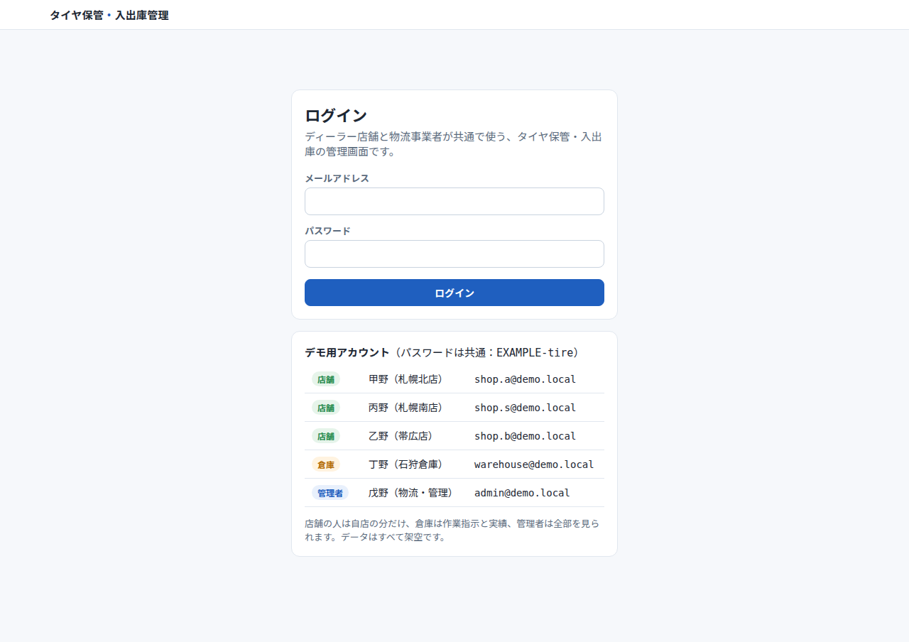

**店舗A：自店の依頼だけが見える**

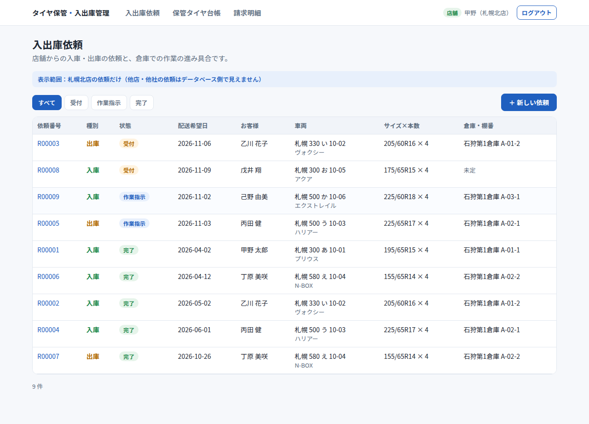

**店舗Aの入庫依頼の入力**

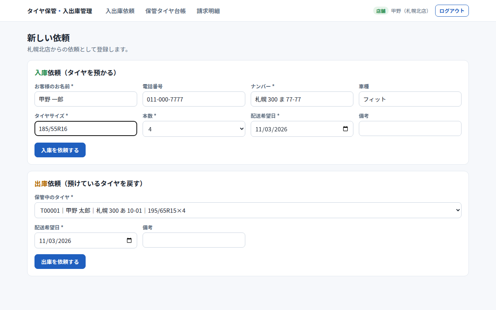

**店舗B（別の法人）：店舗Aの依頼は0件**

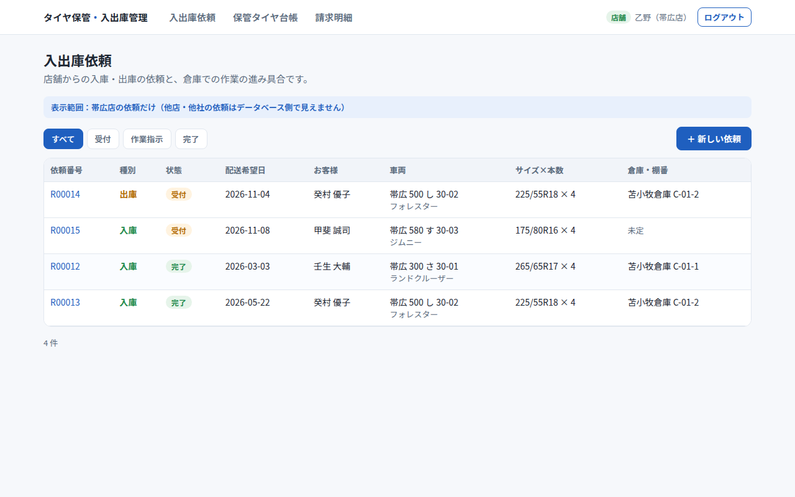

**店舗Bが店舗Aの依頼のURLを直接開いても表示されない**

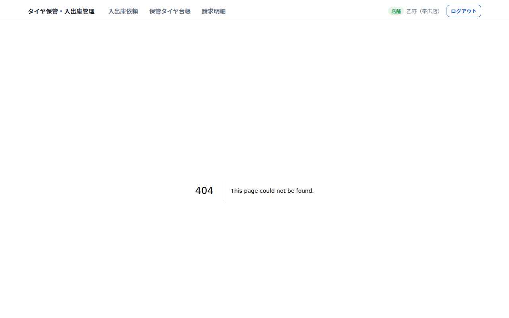

**倉庫：全店舗の依頼**

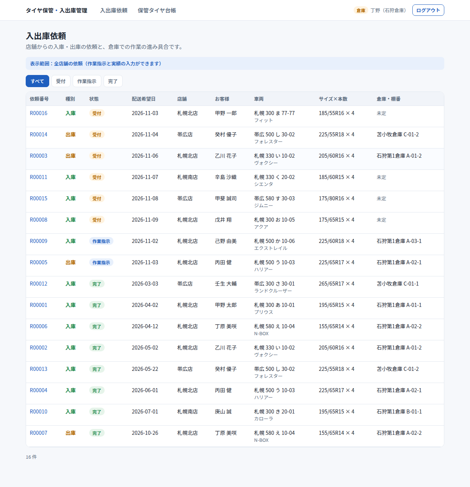

**倉庫：作業指示（倉庫・棚番を決める）**

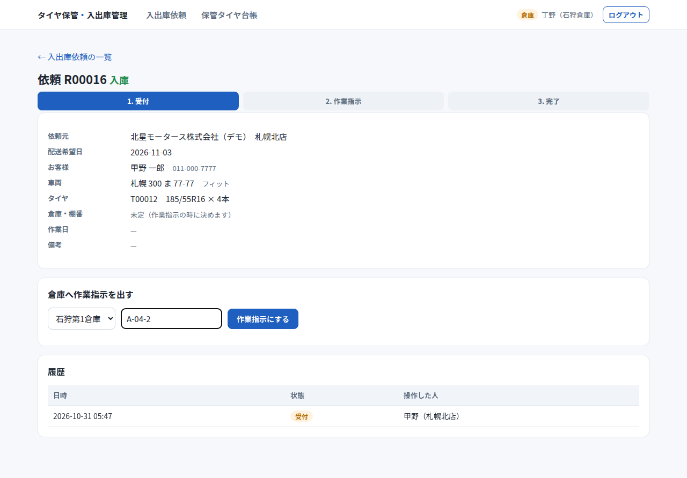

**作業指示書（印刷用）**

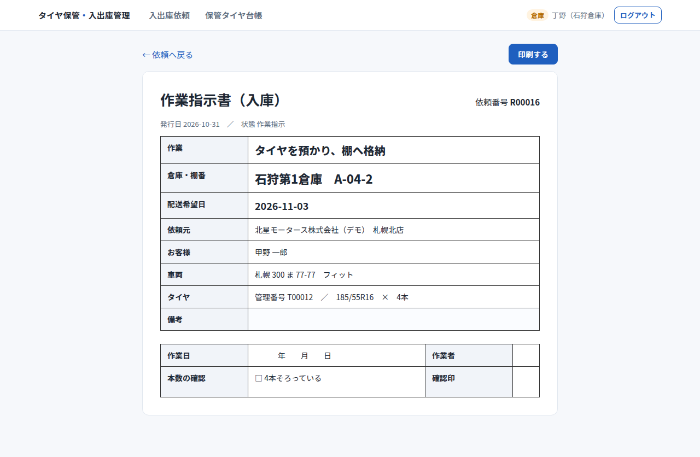

**倉庫：完了の入力と履歴**

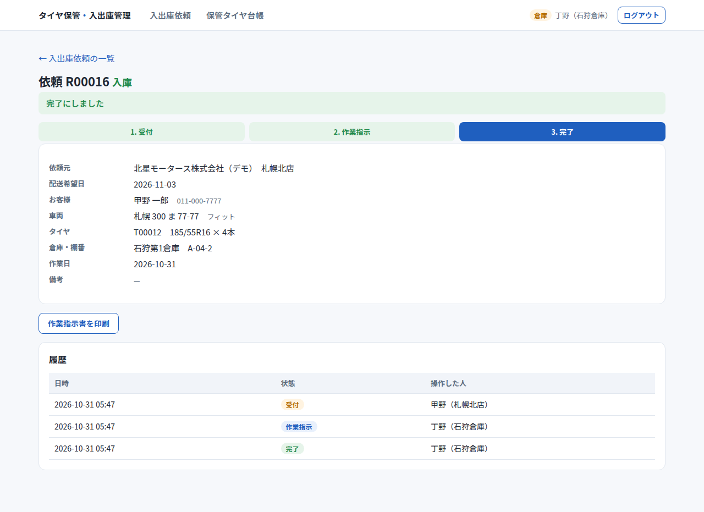

**保管タイヤ台帳（検索・状態・棚番）**

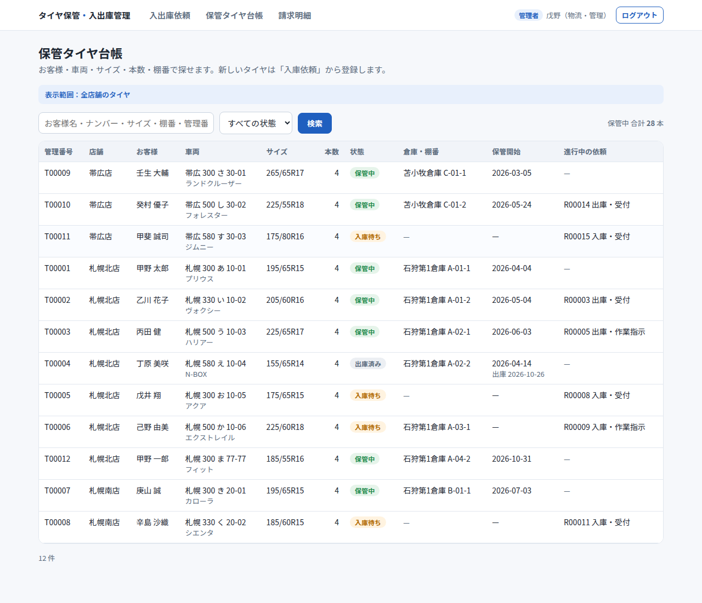

**請求明細（保管料＋入庫・出庫の作業料／CSV・Excel出力）**

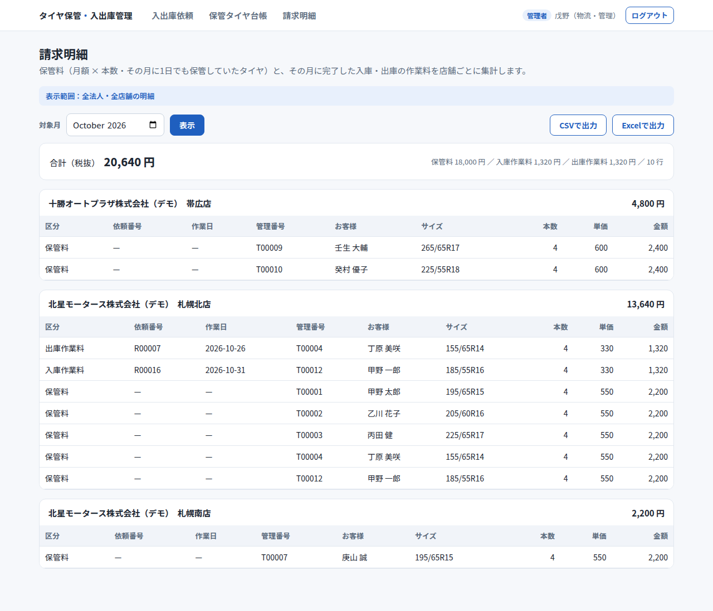

**店舗A：自店の請求だけ（ダークモードの端末でも白い画面）**

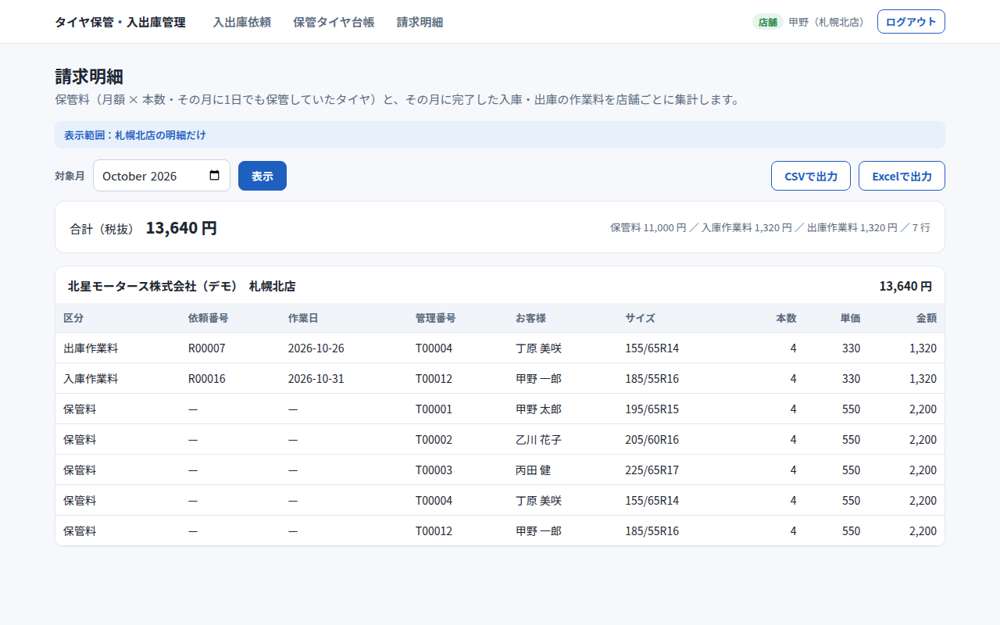

**スマホ幅での依頼入力**

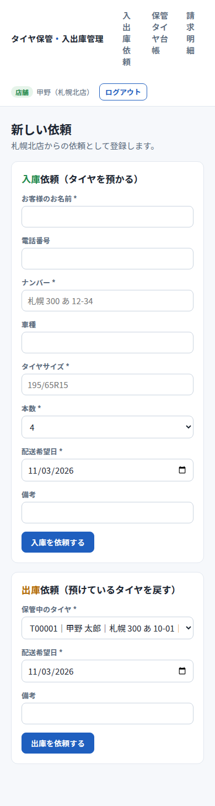
